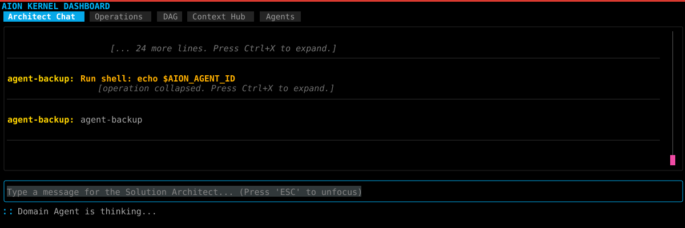

# Aion-Kernel

A 3-Tier Multi-Agent Orchestration OS for concurrent AI agent operations on a shared codebase.



## Architecture

- **Tier 1 — Orchestrator** (Go daemon): Central kernel managing state, locking, IPC, cgroups, and process supervision. Contains zero AI logic.
- **Tier 2 — Domain Supervisor** (in-process): A supervisor object inside the daemon that owns one Pi process tree per domain, including workspace generation, health, and recovery.
- **Tier 3 — Pi Agent** (Node.js, RPC mode): The brain. Runs reasoning loops, writes code, communicates with the Orchestrator via `orchestrator-cli`.

## Quick Start

Linux domain-agent execution requires `bubblewrap` (`bwrap`) and enabled
unprivileged user namespaces. Agent allocation fails closed when either is
unavailable.

```bash
# Build binaries
make build

# Run tests
make test
```

## Usage

You can find the compiled binaries in the `bin/` directory after running `make build`.

### 1. Run the Orchestrator Server (Standalone)
Start the orchestrator daemon in the background or another terminal:
```bash
./bin/aion-kernel server --config configs/aion.yaml
```

The daemon operates on the current directory by default. To run Aion against a
different project from anywhere, pass an explicit project root:

```bash
./bin/aion-kernel server --workdir /path/to/project --config /path/to/aion.yaml
```

One kernel owns a project directory at a time. The daemon holds an exclusive
lock at `.aion/kernel.lock`; a second server on the same project exits with an
error naming the owning PID. Run different projects on distinct ports.

If `--config` is omitted, config discovery checks:

1. `<project>/aion.yaml`
2. `<project>/.aion/aion.yaml`
3. `<project>/configs/aion.yaml`
4. binary-adjacent `configs/aion.yaml`
5. built-in defaults

Environment loading uses kernel defaults with project overrides:

1. `<kernel-root>/.env` where `kernel-root` is resolved from the executable path
   or `AION_KERNEL_ROOT`
2. `~/.config/aion-kernel/.env`
3. `<project>/.env`

The project `.env` is loaded last, so project-specific values can override the
kernel defaults when needed.

### 2. Run an End-to-End Orchestration Task
Submit a task prompt to the Orchestrator to begin planning and allocating agents over the current directory:
```bash
./bin/aion-kernel run --config configs/aion.yaml --prompt "Refactor the authentication logic to use JWTs"
```

### 3. Use the CLI to interact with the DAG
If the server is running, you can manually interact with the Orchestrator via the CLI Pi Agent skill:
```bash
# Read a specific node from the active state
./bin/orchestrator-cli read-dag --node-id "node-123"

# Query the semantic memory (requires memory to be enabled in config)
./bin/orchestrator-cli query-memory --text "authentication" --top-k 5
```

Domain agents negotiate cross-domain boundaries through capability-bound,
durable contracts. The initial contract remains a direct path; tradeoffs can
be negotiated explicitly before publication:

```bash
# At the start of every dispatched turn, inspect the authoritative item.
orchestrator-cli work-inbox --current

# Create or retrieve one stable cross-domain dependency and yield while blocked.
orchestrator-cli contract-ensure \
  --producer-node provider-node \
  --consumer-node consumer-node \
  --resource public-boundary \
  --details '{"kind":"interface","acceptance":["consumer contract test passes"]}' \
  --wait

# Preserve a concise recovery note without duplicating DAG or contract state.
orchestrator-cli work-checkpoint \
  --item consumer-node \
  --summary "local adapter implemented" \
  --next "validate the published boundary"
```

The work inbox is a kernel projection over DAG and coordination WAL state. It
ranks correction, validation, publication, and then ready DAG work while never
preempting an active node. Actionable Context Hub messages wake the relevant
persisted Pi session; fulfilled and terminal notices are projected to
observable history without starting a no-op model turn. Hub messages are
delivery signals, not a second task database. Focused tests remain inside the
owning domain path, for example
`/workspace/<domain>/tests/`, unless another path was explicitly assigned.
Direct `/msg <agent-id> <text>` intervention reopens a stopped agent's
persisted Pi session when that agent is already managed by the current daemon.
After a daemon restart, issue `/continue-agents` once to recreate the persisted
agent set before targeting an individual agent.

Lower-level negotiation remains available when the initial contract cannot be
implemented as written:

```bash
orchestrator-cli contract-propose-terms \
  --contract-id contract-1 --revision 1 \
  --terms '{"details":{"name":"PublicBoundary","kind":"interface"},"tradeoffs":["bounded retry"]}' \
  --rationale "avoid retry amplification"

orchestrator-cli contract-accept-terms --contract-id contract-1 --revision 2
orchestrator-cli contract-standstill --contract-id contract-1 --revision 3 \
  --reason "participants cannot satisfy the same compatibility guarantee"
```

Standstill starts one bounded, source-blind Coordinator reconciliation. Only
the affected nodes pause; ownership from the accepted build plan cannot be
transferred or expanded. Detailed proposal, lease, artifact, validation, and
failure state is available through:

```bash
orchestrator-cli debug-status --key coordination --pretty
```

The main dashboard emits only generic reconciliation status. Detailed review
and approval controls are intentionally deferred to a dedicated observability
surface.

Negotiation and reconciliation limits are configured with
`AION_COORDINATION_MAX_NEGOTIATION_ROUNDS`,
`AION_COORDINATION_MAX_PROCESS_ATTEMPTS`,
`AION_COORDINATION_MAX_REPAIR_ATTEMPTS`,
`AION_COORDINATION_MAX_CONTEXT_EXPANSIONS`,
`AION_COORDINATION_LEASE_TIMEOUT_SEC`, and
`AION_COORDINATION_ARTIFACT_TIMEOUT_SEC`.

## Project Structure

```
kernel/
├── cmd/
│   ├── orchestrator/         # Orchestrator daemon
│   └── orchestrator-cli/     # CLI for agent ↔ orchestrator comms
├── internal/
│   ├── orchestrator/         # Core daemon, gateway, acceptance, recovery
│   ├── dag/                  # mmap-backed JSON DAG + seqlock + WAL
│   ├── locking/              # File-level lock manager
│   ├── supervisor/           # In-process agent process supervisor
│   ├── hub/                  # Context Hub message routing
│   ├── messaging/            # Durable agent-to-agent message registry
│   ├── coordinator/          # Coordinator/Architect Pi processes
│   ├── session/              # Session resilience and checkpoints
│   └── memory/               # Semantic memory (Chromem-Go)
├── flatbuf/                  # Legacy FlatBuffer schema (not in runtime path)
├── skills/                   # Pi Agent skills
├── install/                  # systemd install templates and setup helpers
├── configs/                  # Configuration files
├── scenario/                 # Process and live scenario harnesses
└── test/                     # Integration tests & mocks
```

Durable cross-domain contracts are provided by the composable
`aion-coordination` module; sandbox policy comes from `aion-isolation`. The
kernel remains the only runtime and projects contract effects into the DAG,
Context Hub, and supervisor lifecycle.

## Configuration

See `configs/aion.yaml` and `.env.example` for the default configuration.
For long-running agent turns, tune `AION_PROGRESS_TIMEOUT_SEC`,
`AION_EXTERNAL_ACTIVITY_STALE_TIMEOUT_SEC`, and
`AION_EXTERNAL_ACTIVITY_MAX_DURATION_SEC` so queued or in-flight gateway
requests are not mistaken for stalled agents.
For `/build-spec` planner handoff diagnosis, tune
`AION_COORDINATOR_PLANNER_START_TIMEOUT_SEC` and
`AION_COORDINATOR_PLANNER_FIRST_REQUEST_TIMEOUT_SEC`. To bound the full
Coordinator plan artifact wait, tune
`AION_COORDINATOR_PLANNER_ARTIFACT_TIMEOUT_SEC`.
The Coordinator writes attempt-scoped planning files under
`docs/aion/planning/<attempt_id>/`. It writes `plan_response.json` directly;
the daemon waits for complete JSON and a valid plan before mutating the DAG.

Gateway retries are controlled by `AION_INFERENCE_GATEWAY_MAX_RETRIES`,
`AION_INFERENCE_GATEWAY_RETRY_BASE_DELAY_MS`, and
`AION_INFERENCE_GATEWAY_RETRY_MAX_DELAY_MS`. Runtime concurrency can be changed
with `orchestrator-cli set-gateway-capacity --capacity <N>` or the dashboard's
`/gateway-capacity <N>` command. `/stop-agents` pauses active Domain Agents
without failing their DAG nodes; `/continue-agents` resumes them.

Domain agents run inside mandatory rootless Bubblewrap workspaces. Assigned
project paths are direct writable mounts under `/workspace`; persistent Pi
session state is mounted under `/state/pi`; approved runtime tools and skills
are read-only. Other domains, repository metadata, and kernel runtime state are
not mounted. Every supervisor respawn receives a fresh isolation generation
while the Pi session remains persistent. The monotonic generation counter is
stored in run-owned state outside the agent mount namespace, so pause/resume and
daemon restart cannot reuse a workspace identity.

## Documentation

Architecture documentation lives in the separate `docs` repository at
`docs/current/implementation_arch.md`. It is not included in this repository.
